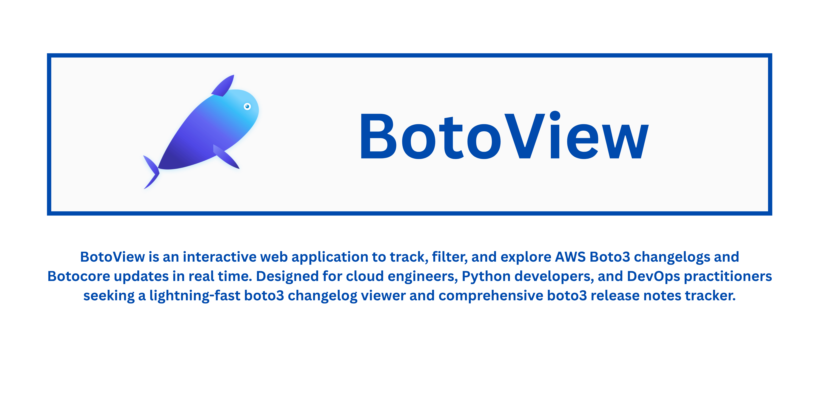
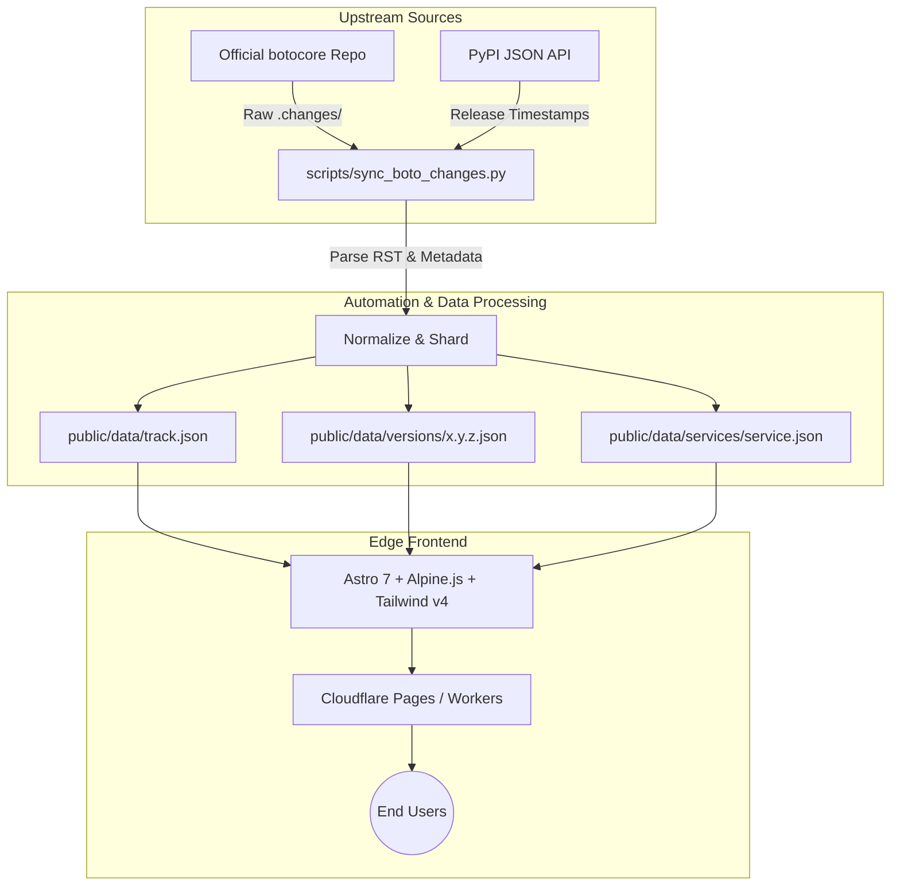

<div align="center">

  <a href="https://botoview.5goos.com">
    
  </a>

  <h1 align="center">BotoView</h1>

  <p align="center">
    <strong>The modern, lightning-fast AWS Boto3 & Botocore changelog explorer, release tracker, and service timeline.</strong>
  </p>

  <p align="center">
    <a href="https://botoview.5goos.com"></a>
    <a href="https://github.com/5goos/botoview/actions/workflows/daily_sync.yml"></a>
    <a href="LICENSE"></a>
  </p>

  <p align="center">
    
    
    
    
    
  </p>

  <p align="center">
    <a href="#why-botoview">Why BotoView</a> •
    <a href="#key-features">Key Features</a> •
    <a href="#keyboard-shortcuts">Keyboard Shortcuts</a> •
    <a href="#architecture">Architecture</a> •
    <a href="#quick-start">Quick Start</a> •
    <a href="#contributing">Contributing</a>
  </p>

  <br />

  <a href="https://botoview.5goos.com">
    
  </a>

</div>

---

<a id="why-botoview"></a>
## 💡 Why BotoView?

AWS releases updates for **Boto3** and **Botocore** nearly every single business day across hundreds of cloud services (Amazon S3, Bedrock, Lambda, DynamoDB, SageMaker, EC2, and 300+ more).

- ❌ **The Old Way:** Sifting through monolithic `CHANGELOG.rst` files or raw Git logs with thousands of commits to figure out *when* a service API changed, *what* broke between versions, or *which* patch added a critical feature.
- ✅ **The BotoView Way:** A sub-millisecond, client-side changelog explorer that decomposes releases by service, categorizes updates (Features, Fixes, API changes), provides full historical service dossiers, and lets you navigate everything with intuitive keyboard shortcuts.

> [!TIP]
> Try the live app at **[botoview.5goos.com](https://botoview.5goos.com)** — no login required, zero latency, always up to date.

---

<a id="key-features"></a>
## 🚀 Key Features

<table>
  <tr>
    <td width="50%">
      <h3>🎯 Service-Level Filtering</h3>
      <p>Isolate changes for any AWS service (e.g. <code>bedrock</code>, <code>s3</code>, <code>dynamodb</code>, <code>lambda</code>). Slide open a comprehensive historical timeline showing every single update for that service across all releases.</p>
    </td>
    <td width="50%">
      <h3>⚡ Real-Time Instant Search</h3>
      <p>Lightning-fast query matching across release tags, pull request descriptions, and service names with automatic keyword highlighting and debounced input.</p>
    </td>
  </tr>
  <tr>
    <td width="50%">
      <h3>🏷️ Categorized Release Notes</h3>
      <p>Easily toggle between <strong>All Changes</strong>, <strong>Features</strong>, and <strong>Bug Fixes</strong> with live change counters. Quickly distinguish between API modifications, enhancements, and patches.</p>
    </td>
    <td width="50%">
      <h3>⌨️ Vim-Style Keyboard Navigation</h3>
      <p>Engineered for power users. Traverse releases with <code>j</code> / <code>k</code>, focus searches with <code>⌘K</code> or <code>/</code>, and toggle themes with <code>t</code> without ever leaving your keyboard.</p>
    </td>
  </tr>
  <tr>
    <td width="50%">
      <h3>📋 Developer Productivity Helpers</h3>
      <p>One-click copy for exact release version tags, changelog snippets, and pre-formatted <code>pip install boto3==x.y.z</code> commands ready to paste into your terminal or requirements file.</p>
    </td>
    <td width="50%">
      <h3>🌓 Adaptive Dark & Light Modes</h3>
      <p>Beautiful, high-contrast user interface styled with Tailwind CSS v4. Seamlessly adapts to your system color scheme or toggle manually at any time.</p>
    </td>
  </tr>
  <tr>
    <td width="50%">
      <h3>🔄 Automated Daily Ingestion</h3>
      <p>A headless Python pipeline powered by GitHub Actions checks PyPI and Botocore daily, indexing new releases and generating sharded JSON data automatically.</p>
    </td>
    <td width="50%">
      <h3>🌐 Featherlight Edge Architecture</h3>
      <p>Static-first architecture built with Astro and Alpine.js. Sharded JSON endpoints guarantee featherlight initial page loads (&lt;50 KB) and global edge delivery via Cloudflare.</p>
    </td>
  </tr>
</table>

---

<a id="keyboard-shortcuts"></a>
## ⌨️ Keyboard Shortcuts

BotoView is designed to be fully navigable without touching your mouse:

| Shortcut | Key | Action | Scope |
|:---|:---:|:---|:---:|
| **Quick Jump to Release** | <kbd>⌘</kbd> + <kbd>K</kbd> or <kbd>Ctrl</kbd> + <kbd>K</kbd> | Focus release version jump-to search bar | Global |
| **Search Services** | <kbd>/</kbd> | Focus the AWS services directory filter | Global |
| **Next Older Release** | <kbd>j</kbd> or <kbd>↓</kbd> | Switch view to the immediately older release | Main View |
| **Next Newer Release** | <kbd>k</kbd> or <kbd>↑</kbd> | Switch view to the immediately newer release | Main View |
| **Toggle Color Theme** | <kbd>t</kbd> | Switch between Dark Mode and Light Mode | Global |
| **Dismiss & Close** | <kbd>Esc</kbd> | Close service drawers, dismiss search inputs & modals | Global |

---

<a id="architecture"></a>
## 🏗️ Architecture & Data Pipeline

BotoView utilizes a static-first, sharded-data architecture that eliminates the need for expensive databases, guarantees zero cold starts, and serves release notes at the edge.



### Why Data Sharding?
Instead of forcing the browser to download a 30+ megabyte monolithic changelog payload:
1. **Initial Shell:** The client downloads only `track.json` (~15 KB gzipped), containing release IDs, dates, and indexed services.
2. **On-Demand Release Fetch:** When selecting a release (e.g. `1.34.160`), only `versions/1.34.160.json` (~2-5 KB) is loaded and cached.
3. **On-Demand Service Dossier:** When opening a service drawer (e.g. `s3`), only `services/s3.json` is fetched and cached.

---

<a id="quick-start"></a>
## 💻 Quick Start

### Prerequisites

- **[Node.js](https://nodejs.org/)** >= 22.12.0
- **[npm](https://npmjs.com/)** >= 10.0.0
- **[Python](https://www.python.org/)** 3.9+ *(only required if executing the data sync pipeline locally)*

### Installation

```bash
# 1. Clone the repository
git clone https://github.com/5goos/botoview.git
cd botoview

# 2. Install JavaScript dependencies
npm install
```

### Running Locally

```bash
# Start the Astro development server
npm run dev
```

Open [http://localhost:4321](http://localhost:4321) in your browser to view the application with hot module reloading.

### Building for Production

```bash
# Build the optimized static application
npm run build

# Preview locally with Cloudflare Wrangler
npm run preview
```

### Running the Data Sync Pipeline

To pull the latest releases from the official Botocore repository and PyPI locally:

```bash
# Install Python dependencies
pip install requests

# Execute the sync job
python3 scripts/sync_boto_changes.py
```

This updates `public/data/track.json`, generates individual version files in `public/data/versions/`, and updates service indexes in `public/data/services/`.

---

## 📂 Project Structure

```text
botoview/
├── .github/
│   └── workflows/
│       ├── codeql.yml             # CodeQL security analysis
│       └── daily_sync.yml         # Scheduled daily sync cron job
├── public/
│   ├── data/                      # Sharded changelog data
│   │   ├── services/              # Individual service histories (e.g., s3.json)
│   │   ├── versions/              # Individual release data (e.g., 1.34.0.json)
│   │   └── track.json             # Master index of releases & services
│   ├── favicon.svg                # Application icon
│   └── og-image.png               # Social preview / OpenGraph banner
├── scripts/
│   └── sync_boto_changes.py       # Python pipeline for Botocore & PyPI extraction
├── src/
│   ├── components/
│   │   ├── LeftRail.astro         # Releases navigation sidebar & jump-to search
│   │   ├── MainView.astro         # Changelog body, filters, and header actions
│   │   └── ServiceNav.astro       # AWS service directory & filter panel
│   ├── layouts/
│   │   └── Layout.astro           # Base HTML shell, SEO meta tags, and OpenGraph
│   ├── pages/
│   │   └── index.astro            # Core page & Alpine.js state controller
│   └── styles/
│       └── global.css             # Tailwind CSS v4 styling & theme tokens
├── astro.config.mjs               # Astro framework configuration
├── package.json                   # Dependencies & build scripts
└── wrangler.jsonc                 # Cloudflare Pages / Workers deployment config
```

---

## 🛠️ Tech Stack

- **Framework:** [Astro](https://astro.build/) (Static Site Generation / Edge Prerendered)
- **Reactivity & State:** [Alpine.js](https://alpinejs.dev/) (Lightweight, declarative client-side state)
- **Styling:** [Tailwind CSS v4](https://tailwindcss.com/) (Modern CSS engine with color schemes and utility classes)
- **Edge Deployment:** [Cloudflare Pages & Workers](https://pages.cloudflare.com/)
- **Data Ingestion:** Python 3, PyPI REST API & Git

---

<a id="contributing"></a>
## 🤝 Contributing

Contributions, bug reports, and feature suggestions are very welcome!

1. **Fork** the repository
2. **Create** your feature branch (`git checkout -b feature/amazing-feature`)
3. **Commit** your changes (`git commit -m 'Add some amazing feature'`)
4. **Push** to the branch (`git push origin feature/amazing-feature`)
5. **Open** a Pull Request

Please ensure your code builds cleanly (`npm run build`) before opening a PR.

---

## 🌟 Show Your Support

If you find **BotoView** helpful for staying on top of AWS updates, please consider giving the repository a **Star** ⭐! It helps others discover the tool.

---

## 📄 License

Distributed under the **MIT License**. See [`LICENSE`](LICENSE) for more information.

---

<div align="center">
  <p>
    Crafted with care by <a href="https://www.thurimerla.com/"><strong>Naveen Thurimerla</strong></a>
  </p>
  <p>
    <a href="https://botoview.5goos.com"><strong>botoview.5goos.com</strong></a>
  </p>
</div>
